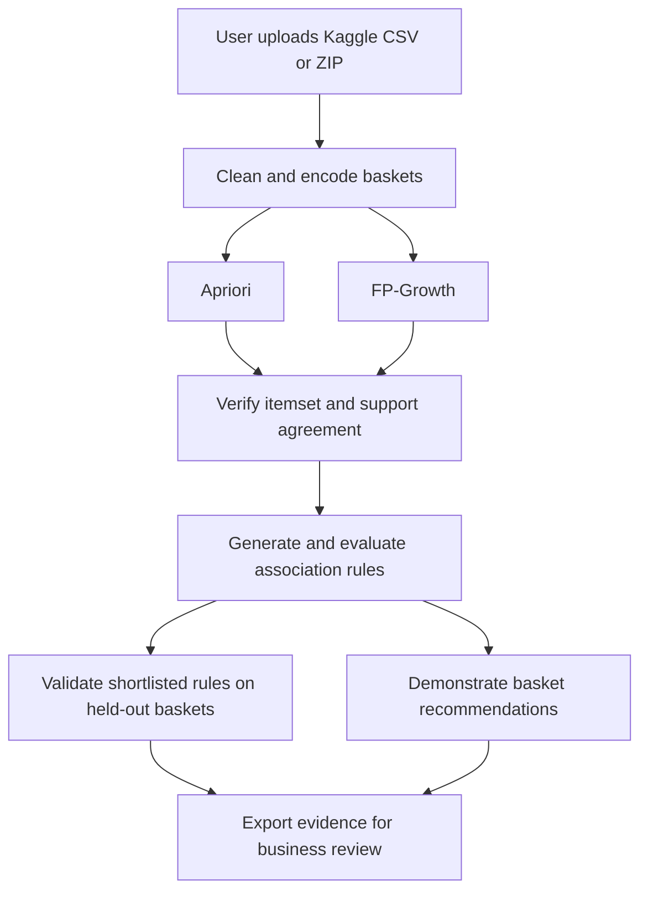
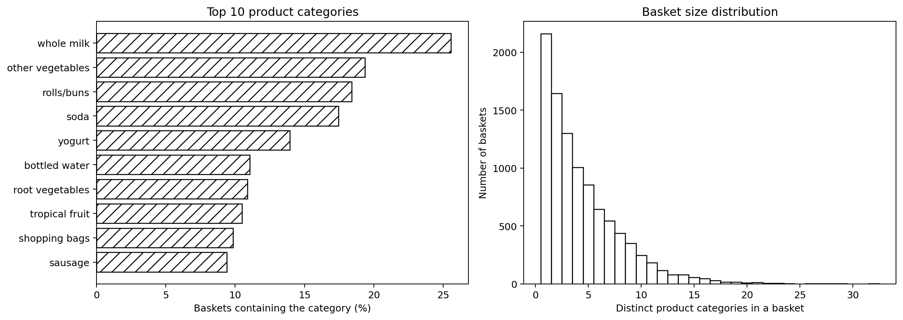
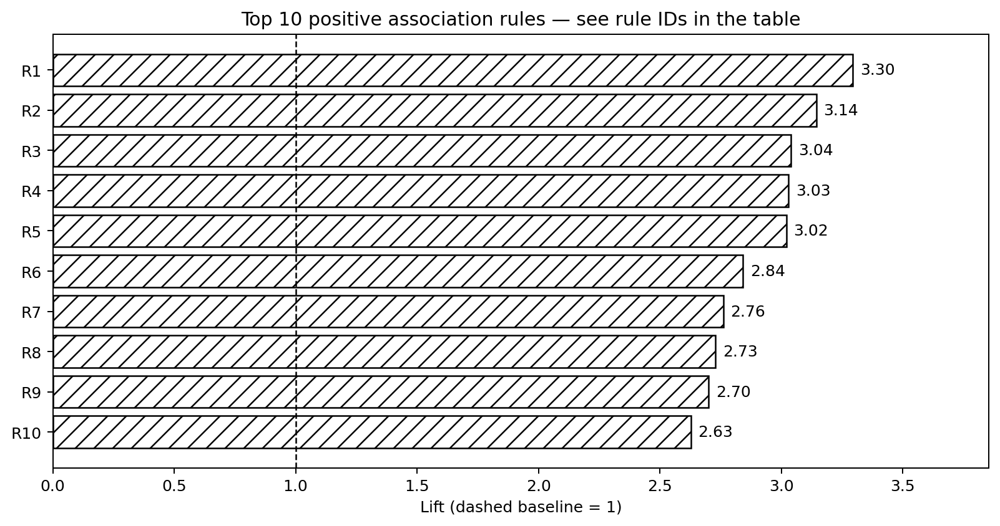
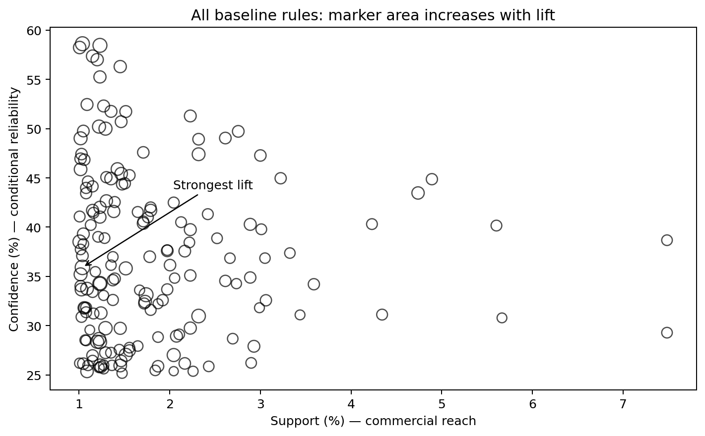
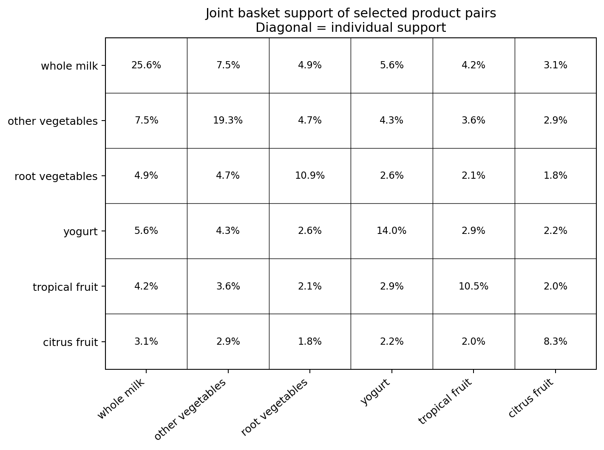

# Market Basket Analysis — Results

This folder contains the exported evidence for the **Data Mining and Business Intelligence CA1–CA2 Market Basket Analysis** project. The numerical files are outputs from the verified notebook run using the Kaggle Groceries dataset. The four charts have been converted to grayscale for black-and-white presentation; their underlying data is unchanged.

## 1. Dataset and run settings

| Setting | Recorded value |
|---|---|
| Dataset | Groceries |
| Kaggle source | https://www.kaggle.com/datasets/irfanasrullah/groceries |
| Canonical dataset documentation | https://michael.hahsler.net/arules/reference/Groceries.html |
| Input representation | Headerless CSV; one shopping basket per row |
| Retained baskets | 9,835 |
| Distinct product categories | 169 |
| Minimum support | 0.01 = 1% |
| Minimum support count | 99 baskets: ceiling of 9,835 × 0.01 |
| Minimum confidence | 0.25 = 25% |
| Positive association filter | Lift > 1 |
| Recommendation rule condition | One consequent product, missing from the input basket |
| Algorithms | Apriori and FP-Growth |
| Validation split | 80% discovery / 20% validation, random seed 42 |

The exact input fingerprint is recorded in `dataset_source.txt` and `run_summary.json`. A differently formatted or modified download can have a different file hash even if its basket contents are equivalent. The original downloaded dataset belongs in the repository's `Dataset/` folder.

## 2. Workflow

The two algorithms are run sequentially for timing. The branches show alternative mining methods, not concurrent execution.

## 3. File inventory

| File | Contents and purpose |
|---|---|
| `01_data_overview.png` | Product-frequency and basket-size exploration. |
| `02_top_rules_lift.png` | Strongest rules by lift at the baseline thresholds. |
| `03_support_confidence.png` | Support versus confidence of the generated rules. |
| `04_pair_support_matrix.png` | Co-occurrence support among selected product pairs. |
| `frequent_itemsets.csv` | Product combinations meeting minimum support. |
| `all_association_rules.csv` | All 170 rules meeting baseline support and confidence conditions, including the rule with lift at or below 1. |
| `positive_rules.csv` | The 169 rules with lift greater than 1. |
| `item_frequencies.csv` | Per-product basket counts and frequency information. |
| `algorithm_benchmark.csv` | Repeated mining-only timings for Apriori and FP-Growth. |
| `threshold_sensitivity.csv` | Itemset and rule counts for nine support/confidence configurations. |
| `holdout_validation.csv` | Discovery and validation evidence for ten shortlisted rules. |
| `demo_recommendations.csv` | Suggestions for the example basket containing curd and whole milk. |
| `cleaned_baskets.csv` | Cleaned transaction baskets used in the analysis. |
| `cleaning_audit.json` | Counts of normalization, removal and retention operations. |
| `environment_versions.json` | Python and analysis-library versions used in the saved run. |
| `run_summary.json` | Dataset identification, thresholds, principal counts and agreement status. |
| `dataset_source.txt` | Source links and the input CSV's SHA-256 fingerprint. |
| `README.md` | Guide to the results, interpretation and reproduction. |

## 4. Verified baseline results

| Result | Value |
|---|---:|
| Apriori frequent itemsets | 333 |
| FP-Growth frequent itemsets | 333 |
| Baseline association rules | 170 |
| Positive rules: lift > 1 | 169 |
| Positive single-consequent recommendation rules | 169 |
| Rule metrics independently checked against basket counts | 170 |
| Shortlisted rules passing held-out screening | 8 of 10 |

The algorithms produced the same frequent itemsets and support values. The 333 itemsets include individual products and larger combinations; they are not 333 recommendations. The baseline describes the complete dataset. The validation experiment separately mines new rules on discovery baskets only.

### Example association

**Citrus fruit + other vegetables → root vegetables**

| Measure | Observed value |
|---|---:|
| Supporting baskets | 102 |
| Support | 1.0371% |
| Confidence | 35.9155% |
| Lift | 3.2950 |

Interpretation: approximately 35.92% of baskets containing both citrus fruit and other vegetables also contain root vegetables. This conditional frequency is about 3.30 times the overall frequency of root vegetables. It supports considering a relevant produce suggestion or display experiment. It does **not** demonstrate a 3.30-fold sales increase or prove that purchasing one product causes another purchase.

### Rule labels used in the lift chart

| Chart ID | Antecedent → consequent | Lift |
|---|---|---:|
| R1 | citrus fruit + other vegetables → root vegetables | 3.30 |
| R2 | other vegetables + tropical fruit → root vegetables | 3.14 |
| R3 | beef → root vegetables | 3.04 |
| R4 | citrus fruit + root vegetables → other vegetables | 3.03 |
| R5 | root vegetables + tropical fruit → other vegetables | 3.02 |
| R6 | other vegetables + whole milk → root vegetables | 2.84 |
| R7 | curd + whole milk → yogurt | 2.76 |
| R8 | other vegetables + yogurt → root vegetables | 2.73 |
| R9 | other vegetables + yogurt → tropical fruit | 2.70 |
| R10 | other vegetables + rolls/buns → root vegetables | 2.63 |

## 5. How to read the metrics

For a rule A → B, where A and B are disjoint product sets:

- **Support** = baskets containing A and B / all baskets. It measures transaction coverage.
- **Confidence** = baskets containing A and B / baskets containing A. It measures the historical conditional frequency of B when A occurs.
- **Lift** = confidence / support of B. Values above 1 indicate positive association relative to B's baseline popularity.
- **Support count** = the actual number of baskets containing the complete combination.

In `all_association_rules.csv`, `support_percent` and `confidence_percent` are already percentages. Do not multiply them by 100 again. Lift is a ratio, not a percentage. Use the CSV column names because different exports may express support as a proportion or a percentage. Rounded percentages should not be used to reconstruct exact support counts.

Classification accuracy, precision and recall are not reported as baseline association-rule measures because this task does not predict predefined class labels. The held-out screening rate is also not a classification accuracy score.

## 6. Algorithm comparison and threshold sensitivity

At 1% minimum support, both algorithms generated 333 frequent itemsets.

| Algorithm | Median mining time, seconds |
|---|---:|
| Apriori | 0.0466 |
| FP-Growth | 0.0819 |

The benchmark uses three repetitions per algorithm and measures frequent-itemset mining only. Data import, preprocessing, rule generation and exports are outside the timing. These timings describe this recorded environment and dataset; they do not establish a universal speed advantage. Timings can change on another machine or after a rerun.

`threshold_sensitivity.csv` shows why thresholds matter. At 0.5% support and 25% confidence, 1,001 itemsets and 673 rules qualify. At 2% support and 25% confidence, 122 itemsets and 49 rules qualify. At 1% support and 60% confidence, no rules qualify. An empty result at stricter thresholds is a valid result.

## 7. Held-out validation and limitations

The seeded split creates **7,868 discovery baskets** and **1,967 validation baskets**. Rules are mined on discovery data only. Ten positive single-consequent rules are shortlisted using discovery lift and confidence, then evaluated on the validation subset.

The exploratory screen requires all of the following on validation data:

- Lift greater than 1.
- Confidence at least 25%.
- Support at least 1%, equivalent to at least 20 joint baskets in this subset.

**Eight of ten shortlisted rules pass.** The two exceptions are:

| Rule | Validation count | Validation confidence | Validation lift | Why it fails |
|---|---:|---:|---:|---|
| Whipped/sour cream + whole milk → root vegetables | 10 | 16.95% | 1.53 | Below the count and confidence conditions. |
| Curd + whole milk → yogurt | 19 | 40.43% | 2.98 | One basket below the minimum joint count of 20. |

The curd-and-milk recommendation remains an illustration of implemented rule-matching logic using the full-data baseline; it is not a fully accepted deployment rule under this validation screen. The screen is exploratory, not a formal significance test. Random hold-out stability does not establish performance in a future season or a different store.

## 8. Recommendation demonstration

The saved example basket is `['curd', 'whole milk']`.

| Suggested product | Matching antecedent | Full-data joint count | Confidence | Lift |
|---|---|---:|---:|---:|
| Yogurt | Curd + whole milk | 99 | 38.52% | 2.76 |
| Other vegetables | Curd | 169 | 32.25% | 1.67 |

The recommender requires every item in a matching antecedent, excludes products already in the basket and deduplicates suggested products. It ranks eligible suggestions using rule evidence. The confidence values describe historical baskets; they are not calibrated purchase probabilities for an individual customer.

## 9. Preprocessing evidence

The recorded cleaning audit reports 408 normalized tokens, no empty tokens removed, no within-basket repeats removed and no empty baskets excluded. All 9,835 baskets were retained. There are 2,824 repeated basket contents retained: identical product combinations can represent separate real shopping transactions and are not automatically deleted as duplicate records.

The cleaned baskets are encoded as a 9,835 × 169 Boolean matrix before mining. A true value means that a category occurs in a basket; this representation does not measure quantity, price or profit.

## 10. Business use and conclusion

The outputs support reviewing product bundles, relevant basket suggestions and coordinated product displays. Managers should consider support, confidence, lift, validation stability, stock availability and margin together.

The prototype demonstrates the technical pipeline and produces explainable evidence. No controlled retailer trial or financial uplift measurement has been performed. A practical next step is a small controlled pilot measuring recommendation uptake, basket value and incremental profit using suitable transaction revenue and cost data.

## 11. How to regenerate and submit

1. Place `Market_Basket_Analysis_CA2_Final.ipynb` in the main project directory.
2. Restart the notebook kernel/runtime and execute the cells in order.
3. Select the downloaded Kaggle CSV or ZIP when the import step asks for it. The import does not automatically search for a dataset.
4. Run through the final export cell. It writes the standard result files into `Results/` relative to the kernel's working directory and creates `Market_Basket_Results.zip` beside that folder.
5. Review the completed summary and outputs before replacing the repository's saved results. The notebook's own chart styling may differ from this grayscale presentation copy.
6. Commit the contents of `Results/` to the project repository. Keep the POC, PPT and notebook in the main project folder, the original dataset in `Dataset/`, and individual YouTube links in the project README/submission sheet.

The file-selection paths were checked using controlled upload/dialog responses, and the analysis cells were executed sequentially with the selected data. This does not certify every operating system or notebook frontend. Missing packages require installation; the recorded versions are listed in `environment_versions.json`.

## 12. Figures

### Dataset overview

### Top rules by lift

### Support and confidence

### Pair support

