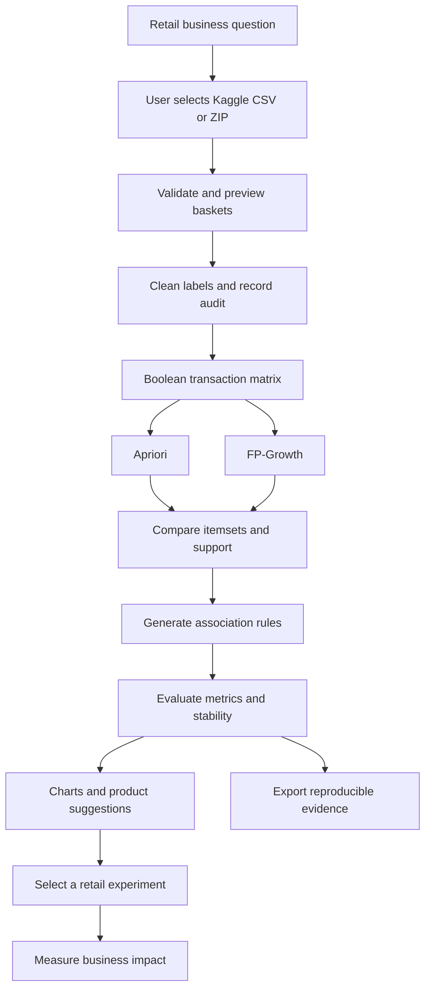
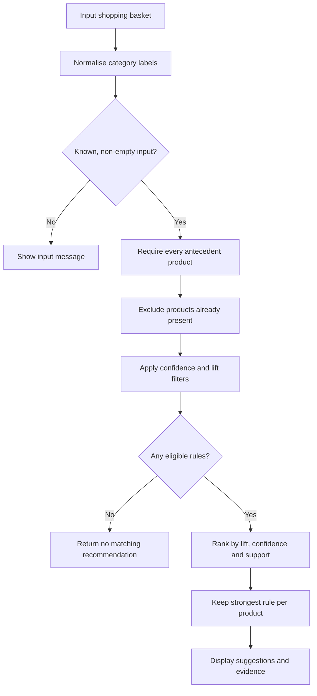

# Market Basket Analysis

## CA1 and CA2 — Data Mining and Business Intelligence

This project analyses grocery shopping transactions to identify products that appear together frequently, evaluate association rules, and demonstrate an explainable product recommendation workflow.

**Business question:** Which product combinations provide enough evidence to justify a retail recommendation, coordinated display, or bundle experiment?

**CA1** analyses the problem, dataset, preprocessing, algorithm choices, evaluation measures, and decision process. **CA2** implements the same case study using **Apriori and FP-Growth**, generates actual results and charts, and demonstrates a basket recommender.

At the baseline settings, the tested implementation processes **9,835 baskets and 169 categories**, discovers **333 frequent itemsets**, and produces **170 association rules**. Of these, **169 have lift greater than 1**. These are analytical results; no revenue or profit improvement is claimed without a business trial.

## Contents

- [Business problem and objectives](#business-problem-and-objectives)
- [Project files](#project-files)
- [Workflow diagram](#workflow-diagram)
- [Dataset and import behaviour](#dataset-and-import-behaviour)
- [Installation and execution](#installation-and-execution)
- [Notebook steps](#notebook-steps)
- [Preprocessing](#preprocessing)
- [Algorithms](#algorithms)
- [Evaluation measures](#evaluation-measures)
- [Verified results](#verified-results)
- [Recommendation logic and diagram](#recommendation-logic-and-diagram)
- [Validation and reproducibility](#validation-and-reproducibility)
- [Generated outputs](#generated-outputs)
- [Business insights and decisions](#business-insights-and-decisions)
- [POC, PPT and individual videos](#poc-ppt-and-individual-videos)
- [Troubleshooting](#troubleshooting)
- [Limitations and future scope](#limitations-and-future-scope)
- [References](#references)

## Business problem and objectives

A grocery retailer can identify popular categories from sales counts, but popularity alone does not establish which products have distinctive co-purchase relationships. Selecting offers solely from frequently sold items can miss useful combinations or discount purchases that customers would have made anyway.

The project therefore aims to:

1. Import and inspect real transaction data from Kaggle.
2. Prepare consistent item-presence records while preserving valid shopping events.
3. Discover frequent itemsets using two suitable algorithms.
4. Generate interpretable antecedent → consequent rules.
5. Evaluate reach, conditional reliability, relative affinity and stability.
6. Recommend associated products missing from an input basket.
7. Connect selected findings to a measurable retail experiment.

The analytical unit is a **shopping basket**, not an individual customer profile. The implementation uses historical category associations rather than an LLM, external recommendation API, or supervised classification model.

## Project files

Use the following paths inside `CA1_CA2_Market_Basket_Analysis/`:

| Path | Purpose | How it is supplied |
|---|---|---|
| `README.md` | Project explanation, execution instructions and submission index | This document |
| `Market_Basket_Analysis_CA2_Final.ipynb` | Complete implementation, descriptions, saved tables and charts | Final notebook |
| `POC.docx` | Editable proof-of-concept document | Prepare separately from the PPT |
| `POC.pdf` | PDF export of the proof-of-concept document | Export from the final POC |
| `Presentation.pptx` | Presentation explaining the case study and implementation | Add the final presentation |
| `Dataset/groceries.csv` | Original downloaded Kaggle basket data | Download and place here for submission |
| `Results/` | Generated CSV, JSON, TXT and PNG evidence | Created when the notebook runs |
| `Market_Basket_Results.zip` | Archive of the generated results | Created beside `Results/` |

**Import behaviour:** Storing the CSV in `Dataset/` organises the submission. The current notebook **does not automatically search that folder**. It always asks the user to select the dataset when Step 2 runs.

Run the notebook from the project directory so that `Results/` and the ZIP are generated in this folder. The output location is based on the kernel's current working directory.

## Workflow diagram



The two algorithm branches represent alternative strategies applied to the same matrix. The notebook executes and times them sequentially; the diagram does not imply concurrent execution. The store experiment and business-impact measurement are proposed next steps, not completed deployment results.

## Dataset and import behaviour

### Source

- **Kaggle dataset:** [Groceries Market Basket Dataset](https://www.kaggle.com/datasets/irfanasrullah/groceries).
- **Canonical description and attribution:** [Groceries in the arules documentation](https://michael.hahsler.net/arules/reference/Groceries.html).

| Property | Value |
|---|---|
| Transactions | 9,835 shopping baskets |
| Product categories | 169 |
| Underlying observation period | 30 days at a grocery outlet |
| Analysis type | Transactional, categorical, item presence |
| Encoded shape | 9,835 rows × 169 columns |
| Mining task | Association Rule Mining |

### Accepted files

The Kaggle download contains two representations of the basket data:

| Input | Format | Handling |
|---|---|---|
| `groceries.csv` | Headerless CSV with a variable number of products per row | Read each row as one basket |
| `groceries - groceries.csv` | Wide table with `Item(s)` and product columns | Remove the header, count column and empty padding; verify row item counts |
| Original dataset ZIP | Archive containing the CSV files | Read the selected archive; prefer the inner `groceries.csv` |

Renaming the selected file does not change how its basket contents are parsed. The dataset is not embedded in the notebook, automatically downloaded, or silently substituted with another source.

A row could contain products such as:

```text
citrus fruit,semi-finished bread,margarine,ready soups
```

This represents one transaction, not four independent transactions.

**Use the linked dataset.** The other commonly encountered grocery table with `Member_number`, `Date`, and `itemDescription` columns requires basket reconstruction and is intentionally rejected by this notebook. Its row count and results are different.

## Installation and execution

### Option A — Google Colab

1. Download the Kaggle dataset ZIP or extract one of the accepted CSV files.
2. Open `Market_Basket_Analysis_CA2_Final.ipynb` in Google Colab.
3. Restart the runtime if you previously ran an older notebook version.
4. Select **Runtime → Run all**.
5. When Step 2 opens **Choose Files**, select **one CSV or ZIP**.
6. Wait for **IMPORT SUCCESS**, then let the remaining cells finish.
7. Check the final **IMPLEMENTATION COMPLETED** summary.
8. Use Colab's Files panel to download `Results/` or `Market_Basket_Results.zip`.

No Kaggle API key or database server is required. Internet is needed for the Kaggle download and any missing package installation. After dependencies and data are available, the analytical pipeline does not require an external service.

### Option B — Local Jupyter or VS Code

Open a terminal in `CA1_CA2_Market_Basket_Analysis/`. The following example uses **Windows Command Prompt**:

```bat
py -m venv .venv
.venv\Scripts\activate
python -m pip install --upgrade pip
python -m pip install jupyterlab pandas numpy matplotlib mlxtend==0.25.0 ipywidgets
python -m jupyterlab
```

Open the notebook, select the intended Python environment, and choose **Restart Kernel and Run All Cells**.

At Step 2:

- A local file-selection dialog asks for the CSV or ZIP.
- If a graphical dialog is unavailable, a prompt asks for the full file path.
- A cancelled selection should be followed by rerunning Step 2 and choosing the dataset.

In VS Code, select the virtual environment as the notebook kernel. Notebook and kernel working directories can differ; use the printed output-folder path to locate generated files.

### Packages and tested environment

The setup cell installs missing analysis packages and records the versions used in each run. Optional widgets are not required for the ordinary basket-input example.

| Component | Role | Recorded tested version |
|---|---|---|
| Python | Notebook execution | 3.12.14 |
| NumPy | Numerical operations and seeded random split | 2.3.5 |
| pandas | Transaction matrix and result tables | 3.1.0 |
| matplotlib | Charts | 3.10.8 |
| mlxtend | Encoding, itemset mining and rule generation | 0.25.0 |
| IPython / Jupyter | Notebook display and execution | Environment-dependent |
| ipywidgets | Optional interactive category picker | Optional |

These versions document the tested environment, not a guarantee that every installation has identical timing or behaviour. The exported `environment_versions.json` records the current analysis-package versions.

## Notebook steps

Every executable cell is immediately preceded by a description of its **purpose**, **operations**, and **expected output and interpretation**.

| Step | What happens | Main evidence |
|---:|---|---|
| 1 | Configure packages, parameters and output directory | Version table and output path |
| 2 | Ask for a Kaggle CSV/ZIP and validate its format | Import-success message and dataset dimensions |
| 3 | Preview raw baskets | First five transactions |
| 4 | Clean labels and record transformations | Cleaning audit and before/after example |
| 5 | Encode item presence and validate the matrix | Boolean matrix and minimum-support count |
| 6 | Explore product frequency and basket size | Summary tables and two chart panels |
| 7 | Run Apriori and FP-Growth | Frequent itemsets, supports and initial times |
| 8 | Generate and filter rules | Baseline and positive-rule tables |
| 9 | Interpret the leading rule | Actual support, confidence and lift explanation |
| 10 | Recalculate metrics directly from baskets | Independent verification of all baseline rules |
| 11 | Work through eight illustrative baskets | Manually understandable metric calculations |
| 12 | Visualise evaluated associations | Lift chart, scatter plot and pair-support matrix |
| 13 | Benchmark and vary thresholds | Repeated timings and nine setting combinations |
| 14 | Check held-out stability | Discovery/validation comparison |
| 15 | Define the recommendation functions | Antecedent matching and ranking logic |
| 16 | Evaluate an editable example basket | Product suggestions and supporting evidence |
| 17 | Offer an optional interactive picker | Product list and Recommend button |
| 18 | Test recommendation edge cases | PASS confirmation |
| 19 | Export evidence and summarise the run | Results files, archive and completion summary |

## Preprocessing

1. **Trim whitespace:** remove surrounding spaces from category labels.
2. **Standardise case:** prevent formatting differences from creating separate labels.
3. **Handle empty tokens:** discard blank product entries where present.
4. **Encode presence once per basket:** repeated quantities are not represented in this task.
5. **Preserve valid repeated baskets:** separate shopping events with identical contents remain separate transactions.
6. **Encode Boolean membership:** True means present and False means absent.
7. **Validate counts:** check shape, data types, missing values, unique columns, non-empty baskets and selected product counts.

For the tested headerless Kaggle CSV, the audit records 408 normalised tokens, no excluded empty baskets, and 2,824 repeated basket contents retained beyond their unique combinations. The repeated-content count is an audit observation, not evidence that those transactions are accidental duplicate records.

Numeric feature scaling is unnecessary because the encoded data represents set membership rather than continuous measurements.

## Algorithms

### Apriori

Apriori discovers itemsets level by level. It counts individual categories, forms larger candidates and prunes any candidate containing an infrequent subset.

Its key property is: **every subset of a frequent itemset must also be frequent**. Adding more products cannot increase the number of baskets containing the entire combination.

Apriori is selected as a transparent baseline that can be verified through counts. Candidate generation and repeated scans can become expensive when many combinations satisfy the threshold.

### FP-Growth

FP-Growth constructs a shared-prefix FP-tree and mines conditional patterns without explicitly generating Apriori's candidate levels. Its advantage depends on how well transactions compress and on the resulting tree structures.

It provides a suitable second approach to the same frequent-itemset task. It is not assumed to be faster in every setting.

### Comparison and rule generation

Both methods use the same cleaned matrix and minimum support. The notebook compares itemset identities and support values before interpreting performance.

**Frequent itemset:** an unordered combination such as `{curd, whole milk, yogurt}`.

**Association rule:** a directional split such as `{curd, whole milk} → {yogurt}`.

Apriori and FP-Growth discover itemsets; the separate rule-generation function calculates eligible antecedent/consequent splits and their metrics.

### Baseline settings

| Parameter | Value | Meaning |
|---|---:|---|
| Minimum support | 0.01 | Combination appears in at least 1% of baskets |
| Minimum supporting count | 99 | Ceiling of 9,835 × 0.01 |
| Minimum confidence | 0.25 | Consequent appears in at least 25% of antecedent baskets |
| Positive-affinity filter | Lift > 1 | Consequent occurs more often with the antecedent than overall |
| Recommendation consequent size | 1 | Suggest one product per matching rule |
| Random seed | 42 | Repeatable discovery/validation split |

## Evaluation measures

Let `N` be the number of baskets. Let `count(A)` count baskets containing every product in A, and `count(A ∪ B)` count baskets containing the full combined itemset.

| Measure | Formula | Interpretation |
|---|---|---|
| Support | `count(A ∪ B) / N` | Frequency of the full combination across all baskets |
| Confidence | `count(A ∪ B) / count(A)` | Fraction of antecedent baskets also containing the consequent |
| Lift | `confidence(A → B) / support(B)` | Conditional frequency relative to baseline popularity |

- **Lift > 1:** positive association.
- **Lift = 1:** independence.
- **Lift < 1:** negative association.

Confidence is directional: reversing a rule can change confidence. A frequent consequent can generate high confidence without distinctive affinity. A high-lift relationship can still have limited reach.

Conventional classification accuracy is not the primary evaluation measure because the project does not predict a supervised target label. A future personalised recommendation task would require its own prediction and ranking evaluation design.

## Verified results

The following results were computed from the selected Kaggle basket data with the baseline settings:

| Result | Value |
|---|---:|
| Retained baskets | 9,835 |
| Categories | 169 |
| Frequent itemsets from Apriori | 333 |
| Frequent itemsets from FP-Growth | 333 |
| Confidence-qualified rules | 170 |
| Positive rules with lift > 1 | 169 |
| Positive single-consequent rules | 169 |
| Itemset/support equivalence | Verified |
| Independent metric verification | All 170 baseline rules |

### Example rules

| Antecedent | Consequent | Supporting baskets | Support | Confidence | Lift |
|---|---|---:|---:|---:|---:|
| Citrus fruit + other vegetables | Root vegetables | 102 | 1.04% | 35.92% | 3.30 |
| Other vegetables + tropical fruit | Root vegetables | 121 | 1.23% | 34.28% | 3.14 |
| Beef | Root vegetables | 171 | 1.74% | 33.14% | 3.04 |
| Curd + whole milk | Yogurt | 99 | 1.01% | 38.52% | 2.76 |

Values are rounded for readability. Exact metrics and counts are exported to `Results/all_association_rules.csv`.

For the first rule, 35.92% of baskets containing both citrus fruit and other vegetables also contain root vegetables. Lift about 3.30 indicates relative co-purchase affinity. **It does not predict a 3.30-fold increase in sales following an offer.**

The eight-basket worked example and controlled recommendation test rule are explicitly illustrative. Their values must not be presented as additional findings from the full Kaggle dataset.

## Recommendation logic and diagram

Use Step 16 to change the example basket:

```python
DEMO_BASKET = ["curd", "whole milk"]
demo_suggestions = explain_basket(DEMO_BASKET)
```

Other examples:

```python
DEMO_BASKET = ["beef"]
```

```python
DEMO_BASKET = ["citrus fruit", "other vegetables"]
```

Use exact category labels. For the full vocabulary:

```python
print("\n".join(sorted(X.columns)))
```



For `{curd, whole milk} → {yogurt}`, both antecedent products must be present. Curd alone does not match that specific rule, although another valid rule with a shorter antecedent could still match.

The recommender excludes yogurt if it is already in the basket. It returns at most five distinct products by default, showing one strongest matching rule for each product. No match is a valid result; recommendations are not fabricated.

The optional Step 17 picker is activated by rerunning its cell in a frontend supporting ipywidgets. The editable list remains available if the widget is unavailable.

## Validation and reproducibility

### Direct metric verification

For every baseline rule, independently count antecedent baskets, consequent baskets and baskets containing both. Recalculate support, confidence and lift and compare them with the library values using numerical tolerance. Also check minimum supporting counts and disjoint antecedent/consequent sets.

### Timing comparison

Run each algorithm three times on the same matrix with the same support threshold. Report median, minimum and maximum mining time. Confirm itemset and support equivalence for every repetition. Hardware, software and workload can affect the timings.

### Threshold sensitivity

Evaluate support values 0.5%, 1%, 2% against confidence values 25%, 40%, 60%. The resulting nine combinations show the trade-off between rule coverage, quantity and reliability. They are exploratory comparisons, not proof of an optimal commercial setting.

### Held-out stability

Use a seeded random split of 7,868 discovery baskets and 1,967 validation baskets. Mine new rules on discovery data only, then recompute selected rule metrics on validation baskets. The baseline full-data analysis remains descriptive; this separate experiment checks stability.

A positive screening flag is not a formal significance test. Random sampling does not establish future-season performance, and validation should not become a repeatedly tuned discovery set.

### Recommendation checks

Controlled tests verify complete antecedent matching, exclusion of already-present products, invalid-input handling and honest no-match behaviour. Additional checks use real rule-based examples.

### Source traceability

Record the selected filename, input format, SHA-256 fingerprint, settings and package versions. Two CSV representations can have different byte-level checksums while representing the same baskets. This does not by itself indicate different transaction content.

## Generated outputs

| File in `Results/` | Description |
|---|---|
| `01_data_overview.png` | Product-frequency chart and basket-size histogram |
| `02_top_rules_lift.png` | Top positive rules ranked by lift |
| `03_support_confidence.png` | Support-confidence scatter plot |
| `04_pair_support_matrix.png` | Selected product-pair joint support |
| `all_association_rules.csv` | Baseline rules with readable item names and metrics |
| `positive_rules.csv` | Rules having lift > 1 |
| `frequent_itemsets.csv` | Itemsets, supports, sizes and supporting counts |
| `item_frequencies.csv` | Category counts and supports |
| `algorithm_benchmark.csv` | Repeated algorithm timing summary |
| `threshold_sensitivity.csv` | Rule counts under alternative settings |
| `holdout_validation.csv` | Discovery/validation rule comparisons |
| `demo_recommendations.csv` | Suggestions from the Step 16 example basket |
| `cleaned_baskets.csv` | Cleaned basket lists; original input is preserved |
| `cleaning_audit.json` | Actual preprocessing counts |
| `environment_versions.json` | Analysis-package and Python versions |
| `run_summary.json` | Dataset identity, settings, result counts and checks |
| `dataset_source.txt` | Dataset links and checksum |

`Market_Basket_Results.zip` is saved in the working project directory, outside `Results/`. Chart images contain black text and marks on a white background. Commit the desired generated evidence to GitHub so that reviewers can inspect results without executing the notebook.

Rerunning the notebook regenerates standard output filenames. Clear unrelated old files from `Results/` before preparing a final archive if you have manually added files there, because the archive includes the directory contents.

## Business insights and decisions

| Finding | Candidate retail action | Evidence required after implementation |
|---|---|---|
| Positive associations among produce categories | Test coordinated placement or relevant produce suggestions | Compare basket value and profit with a control |
| Curd plus whole milk associated with yogurt | Test an eligible-basket yogurt recommendation or offer | Monitor uptake and profit after costs |
| High popularity can inflate confidence | Select bundles using reach, lift and feasibility together | Reject weak, unstable or unprofitable opportunities |

Define eligible transactions, intervention/control assignment, a primary outcome and trial duration before running a store experiment. Check stock availability, discount costs and cannibalisation of other purchases.

Average basket value requires transaction amounts. Unit-based items per basket require quantities; this dataset directly supports **distinct categories per basket**. Incremental profit requires selling prices, product costs and intervention expenses.

## POC, PPT and individual videos

The POC and PPT are separate submission items. The notebook complements both; it does not replace them.

| Deliverable | Suggested content |
|---|---|
| POC document | Problem, objectives, dataset source, feasibility, preprocessing, architecture, algorithm justification, actual screenshots/results, evaluation, limitations and decision proposal |
| PPT | Concise visual explanation of the case study, algorithms, metrics, implemented results, application and conclusions |
| Notebook | Executable implementation with descriptions and evidence |
| Individual videos | Each required group member's own explanation and implementation demonstration |

### Individual video links

Replace the pending entries with the actual member details and links before submission. No video links have been supplied in this README.

| Group member | Name and roll number | Individual YouTube link |
|---|---|---|
| Student 1 | To be added | To be added |
| Student 2 | To be added | To be added |
| Student 3 | To be added | To be added |
| Student 4 | To be added | To be added |

Follow the teacher's actual group allocation. The latest notice requests four individual videos; confirm any difference between that requirement and an earlier three-member title slide.

### Submission readiness

- [ ] Add the final `POC.docx` and its PDF export.
- [ ] Add `Presentation.pptx` separately from the POC.
- [ ] Add the latest `Market_Basket_Analysis_CA2_Final.ipynb`.
- [ ] Add the downloaded dataset under `Dataset/` with source attribution.
- [ ] Restart and execute all cells with the selected Kaggle file.
- [ ] Confirm the completion summary, charts and `Results/` exports.
- [ ] Make PPT and POC figures match the notebook's actual results.
- [ ] Replace all pending member/video entries with real information.
- [ ] Enter the GitHub folder link and all required individual video links in Excel Sheet 2.

## Troubleshooting

| Symptom | Explanation and action |
|---|---|
| Repeated `datetime.utcnow()` deprecation messages during upload | Some older Jupyter clients use a deprecated timestamp helper. The latest setup contains a guarded, session-only compatibility repair. Stop the old run, restart the runtime, clear stale outputs and run the current setup before importing. |
| No upload prompt | The current version always requests manual selection. Ensure that you opened the latest notebook and actually ran Step 2 rather than viewing its saved output. |
| File chooser seems absent in local Jupyter | Look for a separate dialog window. A remote/headless kernel may ask for a full server-side path instead. Colab uses its browser upload picker. |
| Windows path fails in Colab | `C:\Users\...` belongs to your computer and is not a path in the hosted runtime. Upload the file using Choose Files. |
| Dataset dimensions do not match | Use the linked 9,835-basket dataset. The customer/date grocery table is a different input. |
| Both CSVs were selected | Select one CSV or the original ZIP and rerun Step 2. This import cell accepts one selected file. |
| Package installation fails | Check connectivity and permissions in the selected Python environment. Use the local installation command above, then restart the kernel if required. |
| `NameError` after running a later cell | Earlier cells define the required variables/functions. Restart and run all cells in order. |
| Unknown product message | Use exact category names from `X.columns`, such as `whole milk` rather than `milk`. |
| No recommendation | The basket may have no eligible positive rule at the current thresholds. Try a documented example; do not force a fabricated match. |
| Widget does not display | Run the widget cell again in a compatible frontend or use the editable `DEMO_BASKET` cell. |
| Results appear in another folder | Outputs follow `Path.cwd()` in the kernel. Check the printed absolute output-folder path. |

The compatibility repair changes the running session's legacy UTC helper only; it does not edit installed Jupyter package files. Warning suppression is for readability. Invalid data or genuine execution failures remain visible rather than being reported as successful runs.

## Limitations and future scope

### Limitations

- Short, single-outlet observation scope limits generalisation.
- Category-level products hide brand and pack-size differences.
- The basket representation does not establish prices, quantities, margins or customer history.
- Rule rankings depend on support/confidence thresholds and sample composition.
- Existing placement, promotions and availability can influence observed co-purchases.
- Correlation is not causation; rule metrics do not demonstrate incremental commercial impact.

### Possible extensions

- Add product margins, prices and stock levels to prioritise commercially feasible actions.
- Validate across stores, seasons and newer transactions.
- Use high-utility itemset mining when quantities and profits become available.
- Study sequential patterns only when appropriate timestamps and transaction linkage exist.
- Evaluate recommendations in a controlled retail pilot and refresh the rules as behaviour changes.

## References

1. [Kaggle — Groceries Market Basket Dataset](https://www.kaggle.com/datasets/irfanasrullah/groceries).
2. [arules — Groceries dataset documentation and attribution](https://michael.hahsler.net/arules/reference/Groceries.html).
3. Agrawal, R. and Srikant, R. (1994). [Fast Algorithms for Mining Association Rules](https://www.vldb.org/conf/1994/P487.PDF).
4. Han, J., Pei, J. and Yin, Y. (2000). [Mining Frequent Patterns without Candidate Generation](https://sigmodrecord.org/2000/06/07/mining-frequent-patterns-without-candidate-generation/).
5. [mlxtend — TransactionEncoder](https://rasbt.github.io/mlxtend/user_guide/preprocessing/TransactionEncoder/).
6. [mlxtend — Apriori](https://rasbt.github.io/mlxtend/user_guide/frequent_patterns/apriori/).
7. [mlxtend — FP-Growth](https://rasbt.github.io/mlxtend/user_guide/frequent_patterns/fpgrowth/).
8. [mlxtend — Association rules and metrics](https://rasbt.github.io/mlxtend/user_guide/frequent_patterns/association_rules/).

This repository documents an academic proof of concept. Its completed evidence is the implemented and evaluated mining/recommendation workflow; a production deployment and commercial outcome are outside the demonstrated scope.
