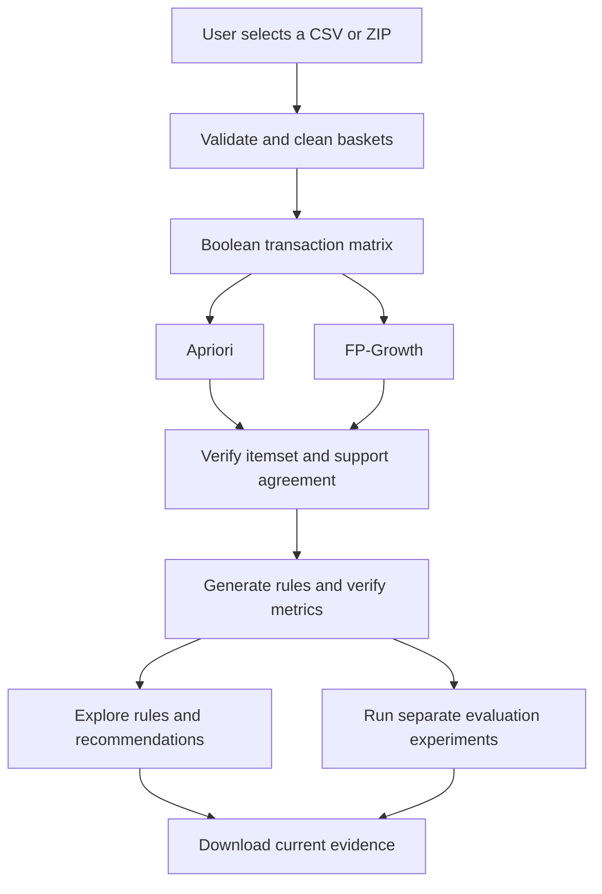

# Market Basket Analysis — Complete CA2 UI Project

A local web application for **Data Mining and Business Intelligence**. Upload shopping baskets, compare Apriori with FP-Growth, inspect association rules, demonstrate product recommendations and export the evidence for your CA1–CA2 submission.

## Tech stack

| Layer | Technology | Purpose |
|---|---|---|
| User interface | Streamlit 1.66.1 | Browser interface, CSV/ZIP upload, controls and downloads |
| Language | Python 3.12 tested; 3.13 accepted by setup | Application and analysis logic |
| Data preparation | pandas 3.1.0, NumPy 2.5.4 | Cleaning, Boolean encoding, counting and validation |
| Data mining | mlxtend 0.25.0 | TransactionEncoder, Apriori, FP-Growth and association rules |
| Interactive charts | Plotly 7.1.0 | Hoverable frequencies, rule charts and pair support |
| Export charts | matplotlib 3.11.2 | Black-and-white PNG evidence without a browser dependency |
| Automated checks | pytest and Streamlit AppTest | Analytical correctness and interface workflows |
| Storage | Uploaded bytes, session state and CSV/JSON/ZIP exports | No database, account or API key required |

The UI uses black text and a white background. Chart marks use black, white and grayscale.

**Graph update:** The **Live charts** page adds instant display filters and an itemset-size chart. Basket recommendation graphs refresh automatically. **Live stream (simulation)** replays the selected dataset in batches with Start, Pause, Next batch and Reset controls. See [the live graphs guide](docs/LIVE_GRAPHS_GUIDE.md) for upgrade and demonstration instructions.

## Quick start on Windows

1. **Extract the complete ZIP** to a normal folder. Do not run files from inside the ZIP preview.
2. Use **Python 3.12** (tested) or your existing **Python 3.13**. If needed, install Python from https://www.python.org/downloads/ and enable the launcher or Add Python to PATH.
3. Double-click **`SETUP_WINDOWS.bat`**. Allow installation to finish. Internet is required for this first package installation.
4. Double-click **`RUN_APP_WINDOWS.bat`**.
5. Streamlit opens a browser. If it does not, open **http://127.0.0.1:8501** manually.
6. In the sidebar uploader, select **`Dataset/groceries.csv`**, your own downloaded Kaggle CSV, or its ZIP.
7. Open **Mine patterns** and click **Run analysis**.

Keep the command window open while demonstrating. Press Ctrl+C there to stop the server.
Do not double-click `app.py` or run it using `python app.py`: it must run through Streamlit.

### Open CMD in the correct folder

1. Open the extracted inner folder containing `app.py` and `requirements.txt`.
2. Click File Explorer's address bar, type `cmd` and press Enter.
3. Confirm that CMD is in the project folder:

```bat
dir app.py
```

If it says File Not Found, you are in the wrong folder. Open the inner project folder and try again.

### Manual Windows commands — first-time setup

Run each command separately. Wait for it to finish before running the next one.

Check your installed Python:

```bat
python --version
```

If this shows Python 3.13.1, you can use that installation with the following commands. Do not use `py -3.12` unless Python 3.12 is actually installed. Python 3.12 remains the version on which this project was tested.

Create the environment:

```bat
python -m venv .venv
```

Check the environment:

```bat
.venv\Scripts\python.exe --version
```

Update pip:

```bat
.venv\Scripts\python.exe -m pip install --upgrade pip
```

Install packages:

```bat
.venv\Scripts\python.exe -m pip install -r requirements.txt
```

Start the app:

```bat
.venv\Scripts\python.exe -m streamlit run app.py --server.address 127.0.0.1 --server.port 8501
```

Open **http://127.0.0.1:8501** in your browser. A Streamlit address in CMD confirms that the server has started; the app's title and upload controls confirm that the application has rendered.

### Starting again after setup

You do not need to reinstall packages every time. Open CMD in the same project folder and run:

```bat
.venv\Scripts\python.exe -m streamlit run app.py --server.address 127.0.0.1 --server.port 8501
```

Keep CMD open while using the app. Press **Ctrl+C in CMD** to stop it. Closing the browser tab alone does not necessarily stop the Python server.

### macOS / Linux

```bash
python3.12 -m venv .venv
.venv/bin/python -m pip install -r requirements.txt
bash run_app.sh
```

The app was tested with Python 3.12.14. Python 3.12 is recommended for reproducing that test environment; Python 3.13 is allowed by the launcher but was not independently tested here. `requirements.txt` pins direct dependencies. `requirements-lock.txt` records all packages from the tested environment, including test tools. A full frozen lock can be platform-sensitive, so the main setup uses `requirements.txt`.

## Dataset and upload behavior

- Kaggle source: https://www.kaggle.com/datasets/irfanasrullah/groceries
- Canonical documentation: https://michael.hahsler.net/arules/reference/Groceries.html
- Case-study shape: **9,835 baskets, 169 product categories**.
- The included headerless CSV has **one transaction basket per row**. Rows can have different numbers of products.
- A wide CSV starting with `Item(s)` also works. Its product count and padding are excluded from the baskets.
- Upload one CSV or ZIP at a time. A ZIP must contain one CSV or a clearly identified `groceries.csv`.
- The app **always asks for an upload**. It never searches folders or automatically reads the bundled dataset.
- The default shape check rejects unrelated inputs. Turn it off for a different headerless basket CSV. The same input format and size limits still apply.
- Files using `Member_number`, `Date` and `itemDescription` belong to a different representation and are rejected with an explanatory message.
- Upload limit: 20 MB, including the selected expanded CSV. Classroom analysis limit: 20,000 baskets and 500 categories.

The SHA-256 fingerprint records exact uploaded CSV bytes. A matching basket/category count alone does not prove identical contents. This representation does not contain prices, quantities, customer identities or timestamps.

## Application workflow



Both algorithms execute sequentially for timing. Branches show the two methods, not parallel execution.

### Pages

| Page | What happens |
|---|---|
| Upload & overview | Show sample baskets, cleaning counts, product frequencies and basket sizes |
| Mine patterns | Run both algorithms, verify agreement and display frequent itemsets |
| Explore rules | Search products, filter positive associations, explain one rule and inspect charts |
| Basket recommendations | Select a basket and generate ranked missing-product suggestions |
| Live charts | Instantly filter rule graphs, change top-product counts and inspect itemset sizes |
| Live stream (simulation) | Replay uploaded baskets with automatically updating support and frequency graphs |
| Evaluation | Run repeated timing, nine threshold configurations and discovery/validation testing |
| Download results | Build and download CSV/JSON/chart evidence, or save a local copy |
| Project guide | Read the assessment workflow, metric definitions and demonstration steps |

Changing the upload or mining thresholds clears old analysis and exports. Changing the recommendation basket or its controls prevents an older recommendation table from being exported as current. The UI does not silently rerun expensive mining when navigating between pages.

## Step-by-step use of the interface

### 1. Upload & overview

Upload `Dataset/groceries.csv` through **Choose one CSV or ZIP** in the sidebar. Keep **Check case-study shape** enabled for the supplied dataset.

Expected overview: **9,835 shopping baskets and 169 product categories**. Inspect the sample baskets, cleaning audit, product-frequency graph and basket-size graph. The app does not search your computer for a file.

### 2. Mine patterns

In the sidebar set:

| Control | Reference setting |
|---|---|
| Minimum support (%) | 1 |
| Minimum confidence (%) | 25 |
| Maximum itemset length | Unrestricted |

Open **Mine patterns** and click **Run analysis**. Wait for the agreement and independent-count checks to finish.

Expected results for the supplied data: **333 frequent itemsets, 170 baseline rules and 169 positive rules**. Changing settings can change these counts. Settings changes invalidate older results; run analysis again before using the other analysis pages.

### 3. Explore rules

Open **Explore rules**. Search for a category such as `root vegetables`. Use **Explain one rule** to select a rule and read its evidence. Hover on the rule charts to inspect values.

For citrus fruit + other vegetables → root vegetables, the reference result is 102 joint baskets, approximately 1.04% support, 35.92% confidence and 3.30 lift. Lift is a ratio against baseline popularity, not a sales increase.

### 4. Basket recommendations

Open **Basket recommendations** and select `curd` and `whole milk`. The table and graph refresh automatically; **Suggest products** is also available as a manual refresh.

The reference suggestions include yogurt and other vegetables. Add yogurt to the selected basket: it should disappear from the suggestions because it is already present. Switch the graph metric between confidence, lift and joint baskets.

A rule needs its entire antecedent to match. An empty suggestion list can be a valid result. Full-data recommendations still need separate validation before business deployment.

### 5. Live charts

Open **Live charts** and change **Number of top products**. Then adjust the display confidence and lift controls. The product graph, rule count and rule graphs update immediately after each control change.

These display controls filter the current mined rule set. They do not mine new rules below its support/confidence floor. To change that floor, use the sidebar settings and run analysis again. The itemset-size graph shows the sizes of actual mined combinations.

### 6. Live stream (simulation)

1. Open **Live stream (simulation)** after mining.
2. Select two different tracked categories, for example whole milk and other vegetables.
3. Set **Baskets per update** to 250 and **Refresh interval** to 1 second.
4. Click **Start replay** to process successive batches automatically.
5. Watch cumulative product/pair support and product counts update.
6. Click **Pause replay** to hold the current position.
7. Click **Next batch** while paused for one controlled update.
8. Click **Reset replay** to start again from zero.

The replay stops at the end and pauses when you leave its page. Undefined confidence or lift appears explicitly when the relevant products have not yet occurred. Download its snapshot CSV from the replay page if needed.

**This is a static-data replay, not a live sales connection.** CSV order is not verified chronological order. The page does not run ADWIN or continually retrain the mining algorithms. Its prefix counts remain separate from the full-data analysis and main results export.

### 7. Evaluation

Run the benchmark, sensitivity and hold-out experiments using their buttons. Benchmarking compares three mining-only repetitions. Sensitivity compares nine support/confidence configurations. Hold-out mining discovers rules only in the discovery subset and tests its shortlist on separate validation baskets.

At the reference settings, eight of ten shortlisted rules pass the exploratory screen. Failed rules remain visible. This pass rate is not classification accuracy or evidence of commercial uplift.

### 8. Download results

After running the experiments and recommendation example you want to include:

1. Open **Download results**.
2. Click **Prepare results ZIP**.
3. Click **Download Market_Basket_UI_Results.zip**.
4. Extract the archive and add its `Results/` contents to the repository.

Only completed optional experiments appear in the ZIP. Offline HTML charts, PNGs, readable CSVs, preprocessing records and run settings are included. Recommendation and itemset-size figures are included when applicable. The optional local-save button creates a fresh timestamped Results subfolder. The replay snapshot is downloaded separately.

## Updating an existing installation

1. Stop the previous server with Ctrl+C.
2. Extract the latest full project ZIP.
3. Copy its updated `app.py`, `market_basket/`, `check_startup.py`, documentation and launch files into your existing project folder.
4. Keep your existing `.venv/`, original input data and any result files you want to preserve.
5. Restart the server and refresh the browser. No additional packages are needed solely for the live-graph update.

Copy this README into the project root, beside `app.py`, to make its relative documentation links work.

## Preprocessing

1. Decode UTF-8 CSV bytes. Read ZIP members in memory without extracting uploaded paths.
2. Recognize headerless baskets or the `Item(s)` wide layout.
3. Normalize labels by trimming whitespace and converting to lowercase.
4. Remove empty tokens and duplicate product labels within a single basket.
5. Exclude empty baskets. Preserve repeated basket contents across transactions.
6. Encode a Boolean transaction matrix for category presence.

The cleaning audit reports actual operations for the selected upload. It does not assume missing values or duplicates were present.

## Algorithms and evaluation

**Apriori** grows candidate itemsets and prunes candidates when a subset is infrequent.
**FP-Growth** mines a compressed frequent-pattern structure. With the same data and restrictions, both should return equivalent itemsets and support values; the app checks this.

Rule metrics:

- Support = joint baskets / all baskets.
- Confidence = joint baskets / antecedent baskets.
- Lift = confidence / consequent support.

Metrics use proportions internally. UI and CSV columns labelled (%) already contain percentages. Lift is a ratio. Every generated rule's support, confidence and lift is independently recalculated from the Boolean matrix.

### Expected reference run

Using the included data, **1% support**, **25% confidence** and **unrestricted itemset length**:

| Measure | Verified value |
|---|---:|
| Baskets | 9,835 |
| Categories | 169 |
| Frequent itemsets from either algorithm | 333 |
| Baseline rules | 170 |
| Positive rules with lift > 1 | 169 |
| Independent rule checks | 170 |
| Minimum support count | 99 |

Example: citrus fruit + other vegetables → root vegetables has 102 joint baskets, approximately 1.04% support, 35.92% confidence and 3.30 lift. These values describe historical association, not a causal sales increase.

### Optional evaluation experiments

- **Repeated benchmark:** three mining-only runs per algorithm. Timings depend on hardware and settings.
- **Sensitivity:** support 0.5%, 1% and 2%, crossed with confidence 25%, 40% and 60%. The selected maximum itemset length remains in effect.
- **Hold-out:** seed 42, 7,868 discovery baskets and 1,967 validation baskets for the canonical dataset. New rules are mined only on discovery baskets. Ten positive single-consequent rules are shortlisted and evaluated separately.

At the reference settings, eight of ten shortlisted rules pass the exploratory screen: validation lift > 1, confidence ≥ 25%, and support ≥ 1% (at least 20 joint validation baskets). The curd + whole milk → yogurt rule has 19 validation baskets and fails the count floor by one. Its demonstration in the recommender illustrates full-data matching, not deployment certification. A random split does not establish future-season performance.

This is association mining. Classification accuracy, precision and recall are not substituted for the rule metrics, and the hold-out pass rate is not classification accuracy.

## Recommendation demonstration

Select **curd** and **whole milk**, then click **Suggest products**.

At the reference settings, suggestions include yogurt (matched antecedent curd + whole milk) and other vegetables (matched antecedent curd). Every antecedent item must be selected. Existing basket products are excluded. Suggestions are deduplicated by product and ranked by lift, confidence and joint count.

These rules suggest a business pilot. They do not predict a guaranteed purchase by an individual customer. Profitability and sales uplift require additional data and a controlled trial.

## Result exports

The ZIP includes current frequent itemsets, all rules, positive rules, product frequencies, initial timings, cleaned baskets, audit records, environment versions, a run summary, offline HTML charts and PNG figures. Optional benchmark, sensitivity, hold-out and recommendation CSV files appear only after those operations run.

Select **Prepare results ZIP** after running the experiments you want to include. Download the archive, extract its `Results/` folder and add it to GitHub. HTML charts embed Plotly JavaScript for offline use. No API or online chart service is needed.

The optional save button writes `Results/run_<UTC timestamp>/` and `Results/Market_Basket_UI_Results.zip`. It does not alter the original dataset. See `Results/README.md` for Git tracking instructions.

## Project files

| File / folder | Purpose |
|---|---|
| `app.py` | Complete Streamlit UI and session workflow |
| `market_basket/core.py` | Upload parsing, cleaning, mining, recommendations and evaluation |
| `market_basket/charts.py` | Monochrome interactive Plotly figures |
| `market_basket/exports.py` | CSV, JSON, HTML, PNG and ZIP exports |
| `market_basket/live.py` | Exact prefix counts and metrics for static-data replay |
| `Dataset/` | Included dataset and attribution |
| `Results/` | Instructions and optional saved local runs |
| `Market_Basket_Analysis_CA2_Final.ipynb` | Existing notebook implementation retained as a separate submission artifact |
| `tests/` | Analytical and Streamlit integration tests |
| `docs/DEMO_SCRIPT.md` | Presentation and demonstration script |
| `docs/TECHNICAL_GUIDE.md` | Function-by-function implementation explanation |
| `docs/TEST_REPORT.md` | Validation scope and recorded outcomes |
| `docs/LIVE_GRAPHS_GUIDE.md` | Update instructions and live-graph demonstration |
| `check_startup.py` | Prints package-loading progress for blank-screen diagnosis |
| `.streamlit/config.toml` | Black-and-white theme and upload configuration |
| `SETUP_WINDOWS.bat` / `RUN_APP_WINDOWS.bat` | Windows setup and launch |

The notebook's own setup instructions remain separate from the UI environment. The notebook is retained, not silently rewritten to depend on Streamlit. Add your existing POC/report, Market Basket presentation and four individual YouTube links to the main submission repository. The separate ADWIN CA3 deck is not part of this CA2 application.

## Run the tests

```bat
.venv\Scripts\python.exe -m pip install -r requirements-dev.txt
.venv\Scripts\python.exe -m pytest -q
```

On macOS/Linux, replace `.venv\Scripts\python.exe` with `.venv/bin/python`.

## Troubleshooting

- **No module named streamlit:** run the setup, then use the virtual environment's Python, not another interpreter.
- **Python not found:** install Python 3.12 and reopen Command Prompt. Check `py -3.12 --version`.
- **Port 8501 is busy:** close an earlier app, or launch with `--server.port 8502`.
- **The file is rejected:** check the dataset link and preview. For your own basket CSV, disable the case-study shape check.
- **No rules appear:** this can be a valid result. Reduce confidence or support and run again.
- **A recommendation is empty:** a basket may have no eligible positive rule. Select products that form a known antecedent.
- **A large custom dataset is slow:** use a higher support threshold or limit the itemset length.
- **Local Results folder is read-only:** use Download results instead of the save button.
- **The browser closes:** the Python process must remain running in the command window.

The app runs locally and processes only selected uploads. The replay is a simulation in CSV file order, without transaction timestamps or a live sales connection. Its metrics do not change the full-data mining run. Automatic updates stop when the page is left or the file ends. No deployment, external publishing, database provisioning or YouTube upload has been performed.

## Blank page or startup troubleshooting

A blank browser page alone does not identify the cause. Check the CMD window for output before changing packages.

1. Allow the first startup time to load scientific packages, then refresh with Ctrl+F5.
2. The updated app renders its title and a package-loading message early. This makes progress visible; it does not guarantee that every startup issue is resolved.
3. If it remains blank, stop the app with Ctrl+C and run:

```bat
.venv\Scripts\python.exe -u check_startup.py
```

The diagnostic prints the package currently loading and how long each import takes. If it stops or shows a traceback, record the last line and the complete error.

4. If every module is ready, restart on another port:

```bat
.venv\Scripts\python.exe -m streamlit run app.py --server.address 127.0.0.1 --server.port 8502
```

Open **http://127.0.0.1:8502** rather than the old address.

If setup fails, record the exact installation error. If the interface still does not appear, provide the CMD output along with the browser screenshot. Avoid deleting or reinstalling everything without identifying the failing step.

## Short demonstration order

**Upload → Data overview → Mine patterns → Explain a rule → Live charts → Basket recommendations → Replay → Evaluation → Export.**

The detailed spoken walkthrough is in `docs/DEMO_SCRIPT.md`. Live-chart instructions are in `docs/LIVE_GRAPHS_GUIDE.md`. Automated test scope and platform limits are in `docs/TEST_REPORT.md`.

## Sources

- Dataset: https://www.kaggle.com/datasets/irfanasrullah/groceries
- Canonical data documentation: https://michael.hahsler.net/arules/reference/Groceries.html
- Apriori: https://www.vldb.org/conf/1994/P487.PDF
- FP-Growth paper: https://sigmodrecord.org/2000/06/07/mining-frequent-patterns-without-candidate-generation/
- mlxtend rules: https://rasbt.github.io/mlxtend/user_guide/frequent_patterns/association_rules/
- Streamlit upload: https://docs.streamlit.io/develop/api-reference/widgets/st.file_uploader
- Streamlit download: https://docs.streamlit.io/develop/api-reference/widgets/st.download_button
- Streamlit charts: https://docs.streamlit.io/develop/api-reference/charts/st.plotly_chart
- Plotly Express: https://plotly.com/python/plotly-express/
